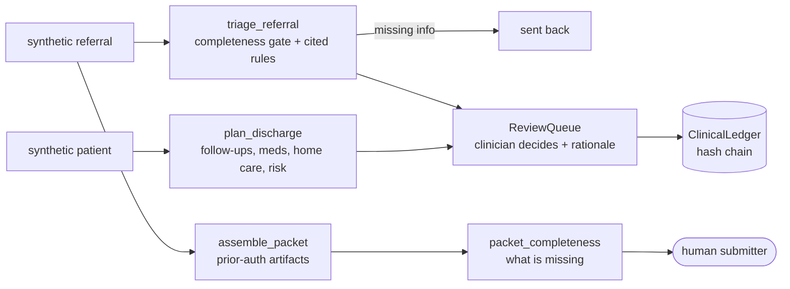

# Jagadish-clinical-ops-agents

[](https://github.com/jagadishmazure-jpg/Jagadish-clinical-ops-agents/actions/workflows/ci.yml)
[](https://github.com/jagadishmazure-jpg/Jagadish-clinical-ops-agents/actions/workflows/codeql.yml)


**Healthcare operations automation (referral triage, prior-authorisation packets, discharge checklists) where every output is a draft and a clinician makes every decision.**

> Personal learning and portfolio project. Everything runs offline on synthetic,
> fictional data with no API keys. Nothing is deployed. Numbers in this README
> come from real runs and are re-checked by CI (`scripts/render_docs.py --check`).

## Recruiter summary

- Automates the paperwork layer around care, not care itself: routing, packet assembly, follow-up checklists.
- Real run on 30 synthetic referrals: 13 routine, 14 urgent, 3 stat, 1 sent back for missing information; every escalation cites rule IDs.
- Safety by construction: no approve/deny API, mandatory clinician rationale, synthetic-only patient type; offline tests and CI with CodeQL and gitleaks.

## Purpose

Hospitals lose time to referral backlogs, prior-authorisation paperwork and
discharge follow-ups that fall through the cracks. This repo shows how agents can
assemble and route that work for a fictional hospital network while leaving every
clinical decision with a clinician. **Synthetic data only. Not medical advice. Not
for clinical use.**

## Architecture



## How it works

- **Triage** (`clinical/triage.py`) checks completeness first (no notes or no
  vitals means the referral goes back), then applies keyword red flags and vital
  thresholds. Two or more independent urgent signals escalate to stat. Each
  decision lists the rule IDs that fired, for example `VITALS-01: systolic_bp 181 >180`.
- **Prior authorisation** (`clinical/priorauth.py`) bundles six required
  artifacts and reports exactly which are missing. It has no approve or deny
  function at all.
- **Discharge** (`clinical/discharge.py`) drafts follow-ups by specialty,
  synthetic medication lists, home-care flags and a weighted readmission-risk
  count (age band, chronic conditions, prior admissions).
- **Review queue** (`clinical/review.py`): nothing is final until a clinician
  records a decision with a non-empty rationale.

The full safety case is in [docs/safety.md](docs/safety.md).

## Real code and output

```python
"""Triage 30 synthetic referrals, assemble a prior-auth packet, draft a discharge plan (offline).

SYNTHETIC DATA ONLY. NOT MEDICAL ADVICE. Every output is a draft for a clinician.
"""
from collections import Counter

from clinical import (
    ReviewItem,
    ReviewQueue,
    assemble_packet,
    gen_referrals,
    packet_completeness,
    plan_discharge,
    triage_referral,
)

referrals = gen_referrals(30, seed=42)
decisions = [triage_referral(r) for r in referrals]
print("Triage of 30 synthetic referrals")
print("  priority:", dict(sorted(Counter(d.priority for d in decisions).items())))
print("  incomplete (sent back for info):", sum(not d.is_complete for d in decisions))
first_stat = next(d for d in decisions if d.priority == "stat")
print(f"  example {first_stat.referral_id}: {first_stat.priority} -> {first_stat.queue}")
for rule in first_stat.rules_triggered:
    print("     rule:", rule)

queue = ReviewQueue()
queue.submit(ReviewItem("RV-1", "triage", first_stat.referral_id, first_stat.rationale))
print(f"  final before clinician decides? {queue.is_final(first_stat.referral_id, 'triage')}")
queue.clinician_decide("RV-1", "approved", "dr.example", "agree with routing")
print(f"  final after clinician decides?  {queue.is_final(first_stat.referral_id, 'triage')}")

packet = assemble_packet("PA-1", referrals[0].referral_id,
                         {"diagnosis_codes": "Z00.00 (SYNTHETIC)", "clinical_notes": referrals[0].clinical_notes})
report = packet_completeness(packet)
print(f"\nPrior-auth packet PA-1: {report.completeness_pct}% complete, submittable={report.submittable}")
print("  missing:", ", ".join(report.missing))
print("  note:", report.note)

patient = referrals[1].patient
plan = plan_discharge("DC-1", patient, [referrals[1].specialty])
print(f"\nDischarge draft DC-1 for {patient.patient_id} (age band {patient.age_band}):"
      f" risk {plan.risk_score} ({plan.risk_tier}), clinician_reviewed={plan.clinician_reviewed}")
print("  follow-ups:", plan.followups)
print("  risk factors:", plan.risk_factors)
```

Output of `python examples/demo.py` (real run, re-checked in CI):

<!-- run: python examples/demo.py -->
```text
Triage of 30 synthetic referrals
  priority: {'routine': 13, 'stat': 3, 'urgent': 14}
  incomplete (sent back for info): 1
  example REF-0007: stat -> dermatology
     rule: VITALS-01: systolic_bp 181 >180
     rule: VITALS-02: heart_rate 126 >120
     rule: ESCALATION-01: >=2 independent urgent signals -> stat
  final before clinician decides? False
  final after clinician decides?  True

Prior-auth packet PA-1: 33.3% complete, submittable=False
  missing: procedure_codes, prior_treatments_tried, imaging_or_labs, referring_provider_npi
  note: Packet assembled for human submitter. This system does not approve or deny authorizations.

Discharge draft DC-1 for PT-0002 (age band 18-39): risk 3 (medium), clinician_reviewed=False
  follow-ups: [{'specialty': 'dermatology', 'within_days': '30'}]
  risk factors: ['3 chronic condition(s)']
```
<!-- /run -->

## How to run

```bash
git clone https://github.com/jagadishmazure-jpg/Jagadish-clinical-ops-agents.git
cd Jagadish-clinical-ops-agents
python -m pip install pytest      # no runtime dependencies
python -m pytest -q          # offline, no keys
python examples/demo.py
python scripts/render_docs.py --check   # documented output still matches
```

Test suite size (real collection, re-checked in CI):

<!-- run: python scripts/count_tests.py -->
```text
28 tests collected
```
<!-- /run -->

## Guardrails

- No autonomous clinical decisions: triage outputs are routing suggestions, packets and plans are drafts.
- `clinician_decide()` refuses an empty rationale and refuses to decide an item twice.
- The prior-auth module has no approval authority by design.
- `SyntheticPatient` raises if constructed as non-synthetic; patients carry age bands, not ages; codes and medicines are marked SYNTHETIC.
- Every event can be recorded on a hash-chained ledger and verified.

## Limitations

- Rules and thresholds are illustrative demo values, not clinically validated.
- Codes are placeholders; there is no terminology service or FHIR integration.
- Risk score is a weighted count, not a validated readmission model.
- Real use would need clinical validation, HIPAA controls and regulatory review, none of which this repo provides.

## Built vs planned

| Capability | Status | Where |
|---|---|---|
| Referral triage with cited rules and completeness gate | Built | `clinical/triage.py` |
| Prior-auth packet assembly and completeness | Built | `clinical/priorauth.py` |
| Discharge checklist draft and risk count | Built | `clinical/discharge.py` |
| Clinician review queue and hash-chained ledger | Built | `clinical/review.py`, `clinical/audit.py` |
| FHIR R4 mapping on Azure Health Data Services | Planned | docs/implementation-guide.md |
| Clinician inbox UI | Planned | not started |
| Clinical validation of rules | Planned | requires clinical partners |

## Implementation guide

The step-by-step path from this offline build to an Azure deployment is in
[docs/implementation-guide.md](docs/implementation-guide.md). None of it has been
run; it is a plan.

## Related repositories

| Repo | How it relates |
|---|---|
| [Jagadish-agentic-data-layer](https://github.com/jagadishmazure-jpg/Jagadish-agentic-data-layer) | Its healthcare domain (fictional Halsey Vale) has governed clinical data products with PHI controls |
| [Jagadish-agentic-ai-model-risk](https://github.com/jagadishmazure-jpg/Jagadish-agentic-ai-model-risk) | Includes a prior-authorisation agent with PHI masking and model risk controls |
| [Jagadish-langchain-langgraph-langsmith](https://github.com/jagadishmazure-jpg/Jagadish-langchain-langgraph-langsmith) | Healthcare scheduling scenarios built with LangGraph |
| [Jagadish-insurance-claims-agents](https://github.com/jagadishmazure-jpg/Jagadish-insurance-claims-agents) | The payer side: claims with a human adjuster gate |

## Documentation

- [Safety case](docs/safety.md)
- [Implementation guide (Azure)](docs/implementation-guide.md)
- [Interview points](docs/interview-points.md)
- [Security policy](SECURITY.md)

## Project layout

```
clinical/
  patients.py   synthetic patients and referrals (seeded)
  triage.py     completeness gate + red-flag and vital rules
  priorauth.py  packet assembly and completeness (no approval API)
  discharge.py  follow-ups, meds, home-care flags, risk count
  review.py     clinician review queue
  audit.py      hash-chained ledger
examples/demo.py the run shown above
tests/           offline pytest suite
```

## License

MIT, see [LICENSE](LICENSE). All data is synthetic; every organisation and person is fictional.
